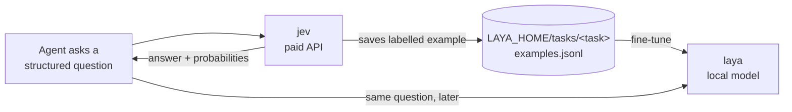

# agent-skills

Agent skills I built and use every day with **Claude Code** and **Codex**. The idea behind them: the main model keeps the thinking and the final word, and narrower or cheaper models take the tasks they are good at.

> 🇧🇷 [Resumo em português](#resumo-em-português) no fim da página. The skills themselves are written in Brazilian Portuguese.

## Skills

| Skill | What it does | Runs on |
|---|---|---|
| [`free`](free/SKILL.md) | Delegates bulk work (code drafts, first tests, summaries of large logs, JSON extraction, second-opinion reviews) to free models through FreeLLMAPI, a local router that falls back across providers when one fails. | Local router → free tiers |
| [`nemo`](nemo/SKILL.md) | Same delegation pattern, pinned to one model: NVIDIA Nemotron 3 Ultra on OpenRouter, for when a 1M-token context matters. | OpenRouter |
| [`jev`](jev/SKILL.md) | Structured decisions (`choice`, `score`, yes/no) through the TypeSafe Jev API. | TypeSafe API |
| [`laya`](laya/SKILL.md) | The same decisions, run by [Laya](https://github.com/NandhaKishorM/laya), a small local model that gets fine-tuned per task, with `jev` as its teacher. | Local, free |
| [`skills-hub`](skills-hub/SKILL.md) | Keeps one Git repository of skills shared by every AI on the machine through links, and audits it for duplicates, leaked keys and broken references. | Git |

## Design principles

**The main model stays in charge.** Delegated output is a draft. The rule in `free` and `nemo` is "the free model drafts; the main model reviews, decides and integrates", and nothing reaches the project, the user or a commit without that review. `jev` and `laya` only return a label or a score, and the main model writes the answer.

**Opt-in, per conversation.** Every skill starts off and only runs after an explicit `$skill on`. They are marked `disable-model-invocation`, so an agent cannot switch them on by itself.

**Keys never touch the files.** Scripts read keys from environment variables (or the OS keychain) at call time, and `status` reports only whether a key exists. The skills tell the agent never to ask for a key in chat.

**Privacy before sending code.** Free tiers may log prompts, so `free` and `nemo` ask once per project before sending any of its code, and refuse secrets, `.env` files and personal data.

**Visible end state.** Each reply that uses a skill ends with a status marker (⚡ used, 🟡 partial, ⚪ not used, 🔴 failed), so it is always clear whether an outside model was involved.

**No dependencies.** The clients are single Python files using only the standard library.

## How `jev` teaches `laya`



Calls to `jev` that name a `laya` task save the text, answers and probabilities as training examples. Once a task has enough of them, `laya` is fine-tuned locally and takes over that decision for free. Because of this link, the two skills should be moved or renamed together.

## How the skills are organised (`skills-hub`)

```
~/.agents/skills/          ← the only real copy, a Git repository (Codex reads it directly)
├── free/  nemo/  jev/  ...
~/.claude/skills/          ← links (junctions on Windows) into ~/.agents/skills
├── free → ~/.agents/skills/free
└── ...
```

Every AI reads the same files, so there is one version of each skill, and every change shows up in `git status`. "Publish" finds a new skill wherever an agent created it, moves it into the repo, links it back, validates it and commits it.

## Install

```bash
git clone https://github.com/caikx11/agent-skills.git
```

Copy or link the skill folders into your agent's skills directory (`~/.claude/skills` for Claude Code, `~/.agents/skills` for Codex). Then follow each skill's `references/` file to set its environment variable:

| Skill | Needs |
|---|---|
| `free` | FreeLLMAPI desktop app running, `FREELLMAPI_KEY` |
| `nemo` | `OPENROUTER_API_KEY` |
| `jev` | `TYPESAFE_API_KEY` |
| `laya` | `pip install laya`; optional `LAYA_HOME` (default `~/.laya`) |
| `skills-hub` | `git`; `gh` to create the GitHub remote |

## Resumo em português

Skills que criei e uso todo dia no Claude Code e no Codex. O modelo principal pensa e decide; modelos mais baratos ou especializados fazem o trabalho em que são bons:

- **`free` e `nemo`** delegam trabalho de volume a modelos gratuitos. O modelo gratuito rascunha, e o principal revisa antes de usar.
- **`jev` e `laya`** tomam decisões estruturadas (escolha, nota, sim/não). O `laya` roda local e aprende com os exemplos que o `jev` gera.
- **`skills-hub`** mantém uma cópia única das skills num repositório Git, compartilhada por todas as IAs por meio de atalhos.

Todas começam desligadas, só rodam depois de `$skill on` e nunca guardam chaves em arquivo.

## License

[MIT](LICENSE)
